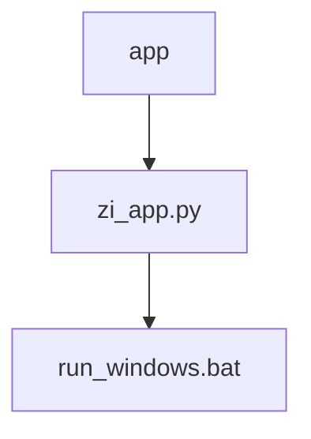

# 📚 zi Documentation

Welcome to the complete documentation for this repository. This documentation is automatically generated and maintained by Woden Docbot.

  

## 🔗 Quick Links

[📂 app](./app/README.md)
[📋 Dependencies](./DEPENDENCIES.md)

---

> A small desktop web app implemented in Python that manages music projects and coordinates export operations.

## 📖 Overview

zi is a compact desktop web application whose core runtime lives in the app directory. The repository centers on zi_app.py, which implements orchestration for project management and export functionality for music projects.

The codebase combines Python application logic with web assets (HTML, JavaScript, CSS) and includes supporting developer files (for example README.md and run_windows.bat). The project declares Python-side dependencies such as fastapi and uvicorn and also contains artifacts for running or packaging (Docker / Docker Compose files are present in the tree).

### 🧩 Key Components

| Component | Purpose | Technologies |
| --- | --- | --- |
| **app** | Hosts the primary runtime code for the desktop web app, including the implementation of project management and export orchestration. | `Python`, `HTML`, `JavaScript` |
| **zi_app.py** | The central implementation file and entry surface for the application-level logic that other components import or invoke. | `Python` |
| **run_windows.bat** | A developer convenience script present alongside the app to facilitate running the application on Windows. | `Batch` |

**Component Architecture:**

### 🏗️ Architecture

A single application module in app/ (zi_app.py) provides the core orchestration; web assets sit alongside it and repository-level scripts and Docker files support running and packaging.

### 💡 Use Cases

- ✦ Manage music project metadata and state
- ✦ Generate and export music project outputs

### 🔧 Technologies

**Languages:**  
     

### 📦 External Dependencies

The following external packages are used across the project:

- `Pillow`
- `fastapi`
- `httpx`
- `pydantic`
- `uvicorn`

---

## 📑 Documentation Sections

### [app](./app/README.md)
Contains the core application module for a small desktop web app that manages music projects and export operations.

The app directory hosts the primary runtime code for the desktop web app.

---

## 📊 Documentation Statistics

- **Files Documented**: 1
- **Directories**: 2
- **Coverage**: 6%
- **Eligible Source Files**: 18
- **Last Updated**: 2026-11-27

---

## 🧭 How to Navigate

> ℹ️ **INFO**
> Each directory has its own README.md with detailed information about that section. Use the breadcrumb navigation at the top of each page to navigate back to parent directories.

### Navigation Features

- **Breadcrumbs** - At the top of each page, showing your current location
- **Directory READMEs** - Each folder has a comprehensive overview
- **File Documentation** - Click through to individual file documentation
- **Search** - Use GitHub's search or your IDE's search functionality

---

## 🤖 About Woden DocBot

This documentation is automatically generated and kept up-to-date by Woden DocBot, an AI-powered documentation assistant. DocBot analyzes code on every pull request and updates documentation to reflect changes.

### Features

- **Automatic Updates** - Documentation updates on every PR
- **Comprehensive Coverage** - Files, functions, classes, and directories
- **Smart Navigation** - Breadcrumbs, related files, and parent links
- **AI-Powered** - Uses Azure GPT models for intelligent documentation generation

---

*Generated by Woden DocBot for zi*