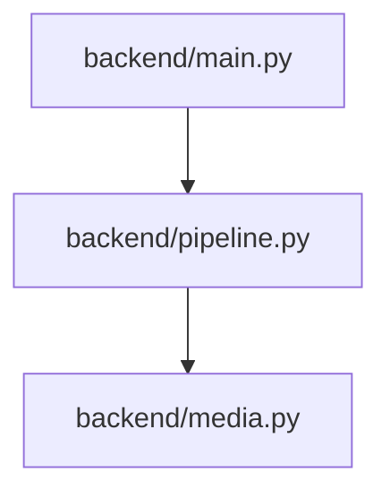

# 📚 zi Documentation

Welcome to the complete documentation for this repository. This documentation is automatically generated and maintained by Woden Docbot.

  

## 🔗 Quick Links

[📂 backend](./backend/README.md)
[📋 Dependencies](./DEPENDENCIES.md)

---

> A Python-based backend that exposes an HTTP API and orchestrates audio generation, asset preparation, and packaging for release distribution.

## 📖 Overview

zi provides backend components for generating and packaging multi-section audio pieces and preparing release assets. The backend exposes an HTTP API (implemented in main.py with FastAPI) to trigger and query work, orchestrates an audio generation and packaging pipeline (pipeline.py) that stitches segments into a single master of at least 180 seconds and performs licence/model-spec checks, and prepares a RouteNote-compatible release package.

Media utilities (media.py) handle low-level preparation of audio and cover art assets for distribution. The codebase is implemented in Python and is arranged so the API surface invokes the pipeline and media utilities to produce finished releases.

### 🧩 Key Components

| Component | Purpose | Technologies |
| --- | --- | --- |
| **backend/main.py** | Implements the HTTP API surface for the Zi service, exposing endpoints to trigger or query audio generation and packaging work. | `Python`, `fastapi` |
| **backend/pipeline.py** | Coordinates the audio generation and packaging pipeline: produces multi-section musical pieces, stitches segments into a single master (>=180s), checks licence and model specifications, and prepares a RouteNote-compatible release package. | `Python` |
| **backend/media.py** | Provides utilities for preparing audio and cover art assets required for distribution and release packaging. | `Python`, `Pillow` |

**Component Architecture:**

### 🏗️ Architecture

A Python backend directory houses three primary modules (main.py, pipeline.py, media.py): main.py is the FastAPI HTTP surface, pipeline.py orchestrates generation and packaging, and media.py prepares audio/cover assets for distribution.

### 💡 Use Cases

- ✦ Triggering and querying audio generation and packaging jobs via HTTP
- ✦ Coordinating multi-section musical piece generation and stitching segments into a master track of at least 180 seconds
- ✦ Performing licence and model-spec checks and preparing a RouteNote-compatible release package
- ✦ Preparing audio files and cover art assets for release distribution

### 🔧 Technologies

**Languages:**  

**Frameworks:** 
    

### 📦 External Dependencies

The following external packages are used across the project:

- `Pillow`
- `fastapi`
- `httpx`
- `pydantic`
- `uvicorn`

---

## 📑 Documentation Sections

### [backend](./backend/README.md)
Contains the backend service components for the Zi service: the HTTP API surface, audio/media asset utilities, and the audio generation and packaging pipeline.

This directory hosts the core backend components used by the Zi service.

### Files at the repository root

- [music-studio.js](./music-studio.js.md)
- [single-file-app.html](./single-file-app.html.md)

---

## 📊 Documentation Statistics

- **Files Documented**: 5
- **Directories**: 2
- **Coverage**: 29%
- **Eligible Source Files**: 17
- **Last Updated**: 2026-11-25

---

## 🧭 How to Navigate

> ℹ️ **INFO**
> Each directory has its own README.md with detailed information about that section. Use the breadcrumb navigation at the top of each page to navigate back to parent directories.

### Navigation Features

- **Breadcrumbs** - At the top of each page, showing your current location
- **Directory READMEs** - Each folder has a comprehensive overview
- **File Documentation** - Click through to individual file documentation
- **Search** - Use GitHub's search or your IDE's search functionality

---

## 🤖 About Woden DocBot

This documentation is automatically generated and kept up-to-date by Woden DocBot, an AI-powered documentation assistant. DocBot analyzes code on every pull request and updates documentation to reflect changes.

### Features

- **Automatic Updates** - Documentation updates on every PR
- **Comprehensive Coverage** - Files, functions, classes, and directories
- **Smart Navigation** - Breadcrumbs, related files, and parent links
- **AI-Powered** - Uses Azure GPT models for intelligent documentation generation

---

*Generated by Woden DocBot for zi*